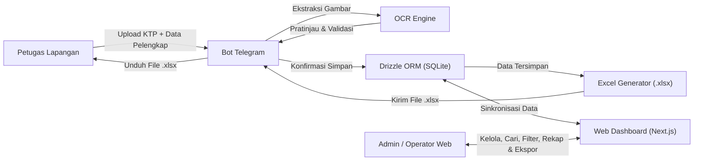
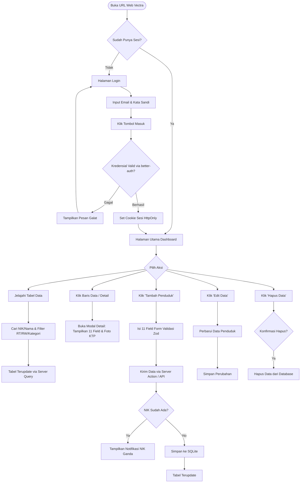
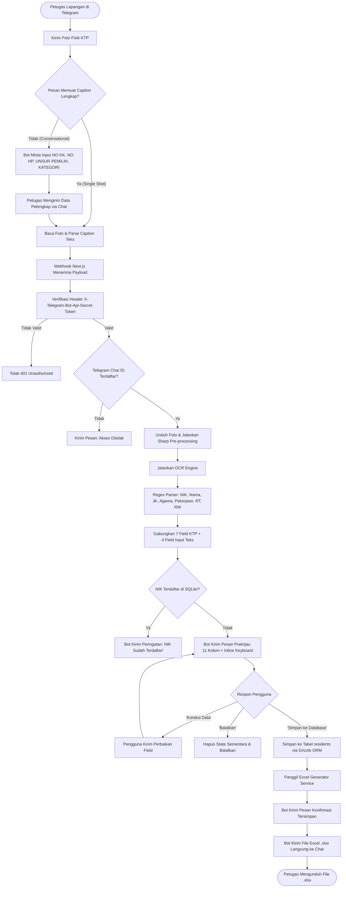
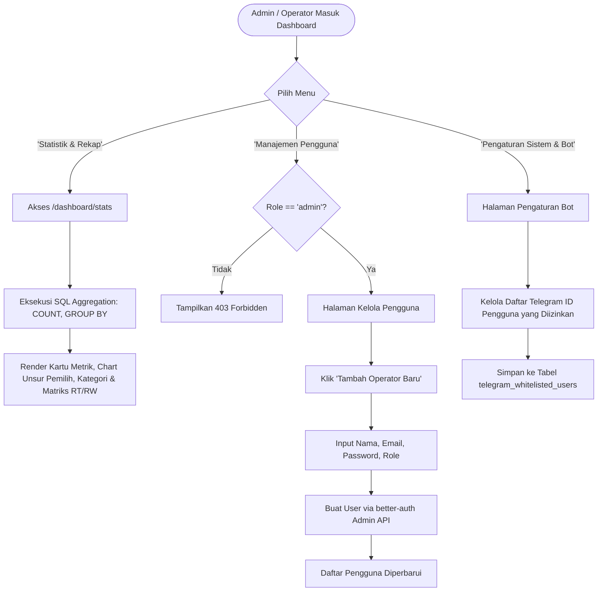
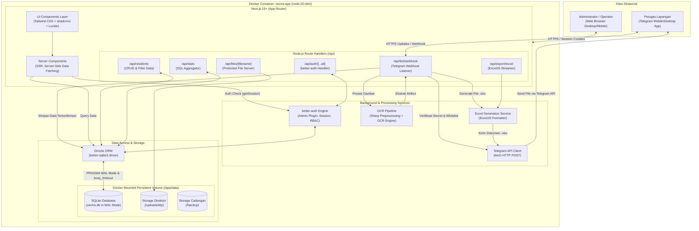
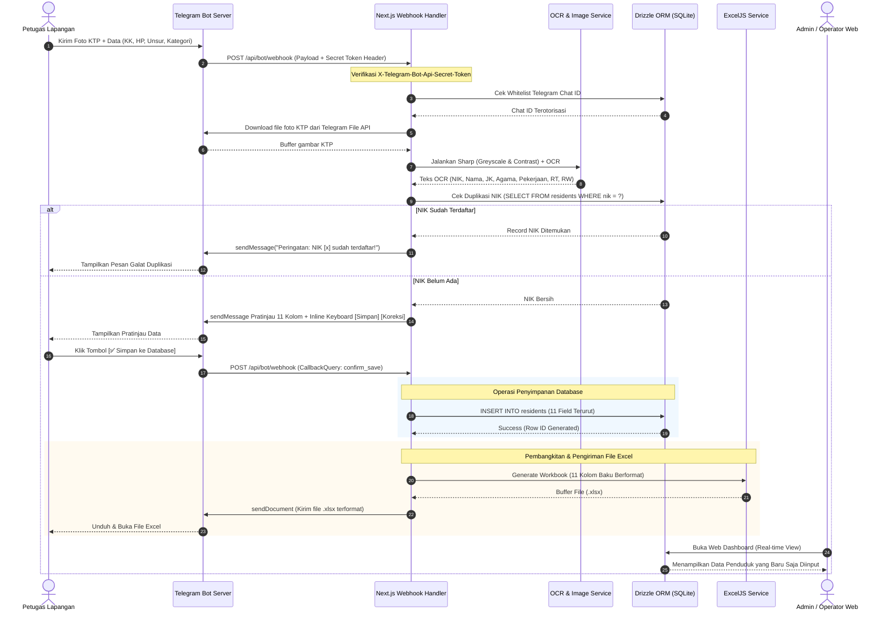
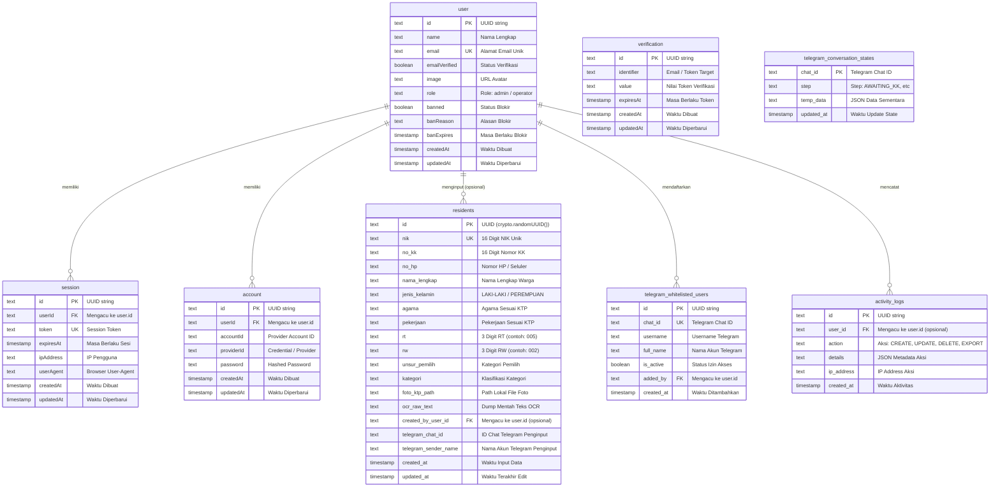
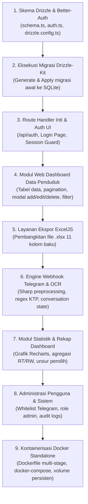

# PRD — Project Requirements Document
# Sistem Vectra: Sistem Administrasi Dokumen Kependudukan & Integrasi Bot Telegram

---

## 1. Overview

### 1.1 Konteks Masalah
Proses pendataan dan administrasi dokumen kependudukan—terutama untuk pemetaan pemilih, verifikasi konstituen, pendataan bansos, atau registrasi warga di tingkat lapangan—sering kali menghadapi kendala efisiensi yang signifikan:
- **Input Manual yang Lambat & Rentan Kesalahan**: Petugas di lapangan harus mencatat atau mengetik ulang 16 digit NIK, nomor KK, nama lengkap, RT/RW, dan alamat secara manual. Hal ini memakan waktu rata-rata 3–5 menit per orang dan memiliki rasio kesalahan ketik (*human error*) yang tinggi (terutama tertukar digit angka 1, 7, 0, dan 8 pada NIK).
- **Pengumpulan Data Terfragmentasi**: Data sering kali dikirimkan melalui grup obrolan (WhatsApp/Telegram) secara berserakan berupa foto KTP tanpa format metadata yang baku, sehingga koordinator pusat kewalahan merekap data tersebut ke dalam lembar kerja (*spreadsheet*).
- **Keterlambatan Pelaporan & Duplikasi Data**: Tidak adanya validasi duplikasi data seketika di lapangan menyebabkan data ganda (NIK terdaftar ganda), serta laporan berformat Excel (`.xlsx`) baru dapat disajikan berhari-hari setelah kegiatan lapangan selesai.
- **Ketiadaan Platform Terpusat Berkeamanan Tinggi**: Banyak tim lapangan tidak memiliki sistem terpadu yang membatasi hak akses antara operator lapangan dan administrator verifikator, sehingga rentan kebocoran data pribadi (UU Perlindungan Data Pribadi / PDP).

### 1.2 Solusi Utama Aplikasi (Vectra)
**Vectra** adalah platform administrasi kependudukan hibrida (*hybrid field-and-web administration system*) yang mengintegrasikan:
1. **Bot Telegram Interaktif & OCR Engine**: Berfungsi sebagai antarmuka input garis depan bagi petugas lapangan. Petugas cukup mengunggah foto KTP dan mengirimkan atribut pelengkap (NO KK, NO HP, UNSUR PEMILIH, dan KATEGORI). Bot secara otomatis mengekstrak data identitas via OCR (Optical Character Recognition), meminta konfirmasi validasi pengguna, menyimpan data ke database, dan **secara otomatis menghasilkan serta mengirimkan kembali dokumen Excel (`.xlsx`) hasil input seketika**.
2. **Web Dashboard Responsif & Terpusat (Next.js + Tailwind + shadcn/ui)**: Berfungsi sebagai pusat kontrol data bagi Administrator dan Operator. Menyediakan fitur manajemen data kependudukan (CRUD, pencarian instan, filter multi-dimensi, paginasi cepat), visualisasi statistik demografi penduduk, audit trail, manajemen akun berbasis peran via `better-auth`, serta ekspor dataset kustom ke format Excel (`.xlsx`).
3. **Penyimpanan SQLite Kinerja Tinggi (Drizzle ORM)**: Menggunakan embedded database SQLite dengan konfigurasi Write-Ahead Logging (WAL) yang ringan, cepat, tanpa latensi jaringan database, dan mudah dipelihara dalam satu *container* Docker dengan volume persisten.

### 1.3 Alur Penggunaan Inti


### 1.4 Daftar Tujuan Utama (Goals & Key Metrics)
- **Otomatisasi Input**: Memangkas waktu entri identitas kependudukan dari 3–5 menit menjadi di bawah 30 detik per data.
- **Presisi OCR & Penurunan Typo**: Mencapai akurasi pembacaan NIK, Nama, dan field KTP > 95% dengan antarmuka konfirmasi koreksi sebelum penyimpanan.
- **Standarisasi Struktur Data**: Menjamin seluruh data kependudukan tersimpan dan diekspor dalam urutan kolom terstandarisasi:
  $$\text{NIK} \rightarrow \text{NO KK} \rightarrow \text{NO HP} \rightarrow \text{NAMA LENGKAP} \rightarrow \text{JENIS KELAMIN} \rightarrow \text{AGAMA} \rightarrow \text{PEKERJAAN} \rightarrow \text{RT} \rightarrow \text{RW} \rightarrow \text{UNSUR PEMILIH} \rightarrow \text{KATEGORI}$$
- **Instant Reporting**: Menghasilkan file `.xlsx` secara otomatis langsung ke ruang obrolan Telegram dalam hitungan detik setelah data tersimpan.
- **Tata Kelola & Keamanan Data**: Menerapkan autentikasi modern berbasis peran (`admin` dan `operator`), menutup registrasi publik tanpa otorisasi, serta mengamankan webhook Telegram dengan secret token.

---

## 2. Requirements

### 2.1 Persyaratan Fungsional Utama

#### A. Integrasi Bot Telegram & Pemrosesan KTP
1. **Penerimaan Berkas & Input Metadata**:
   - Bot mampu menerima input foto fisik KTP (baik sebagai gambar langsung maupun lampiran dokumen kompresi).
   - Pengguna mengirimkan 4 parameter teks wajib:
     - `NO KK` (Nomor Kartu Keluarga, 16 digit numerik).
     - `NO HP` (Nomor Telepon/Handphone aktif, format valid Indonesia).
     - `UNSUR PEMILIH` (misal: Pemilih Tetap, Pemilih Pemula, Pindah Domisili, Tokoh Masyarakat, Disabilitas, dll).
     - `KATEGORI` (misal: Prioritas 1 / Ring 1, Prioritas 2, Simpatisan, Relawan, Umum).
   - Bot mendukung dua mode interaksi:
     - *Single Shot*: Mengirimkan foto KTP dengan *caption* teks berisi format data pelengkap.
     - *Conversational Step-by-Step*: Pengguna mengirim foto KTP terlebih dahulu, lalu bot memandu pengguna memasukkan NO KK, NO HP, UNSUR PEMILIH, dan KATEGORI secara berurutan.
2. **Ekstraksi Otomatis via OCR**:
   - Engine OCR memproses foto KTP untuk mengekstrak 7 field identitas:
     - `NIK` (Nomor Induk Kependudukan, 16 digit angka).
     - `NAMA LENGKAP` (Nama lengkap sesuai e-KTP, huruf kapital).
     - `JENIS KELAMIN` (Normalisasi: LAKI-LAKI / PEREMPUAN).
     - `AGAMA` (ISLAM, KRISTEN, KATOLIK, HINDU, BUDDHA, KONGHUCU, LAINNYA).
     - `PEKERJAAN` (Pekerjaan sesuai KTP).
     - `RT` (Rukun Tetangga, 1–3 digit numerik, normalisasi ke 3 digit misalnya `005`).
     - `RW` (Rukun Warga, 1–3 digit numerik, normalisasi ke 3 digit misalnya `002`).
3. **Verifikasi & Pratinjau Interaktif**:
   - Bot menyajikan ringkasan 11 field yang telah digabungkan ke ruang obrolan Telegram.
   - Tersedia tombol interaktif Telegram (*Inline Keyboard*):
     - `[✅ Simpan ke Database]`: Menyimpan data ke SQLite.
     - `[✏️ Koreksi Data]`: Memungkinkan pengguna memperbaiki field yang salah terbaca sebelum commit.
     - `[❌ Batalkan]`: Membatalkan transaksi input.
   - Pengecekan duplikasi NIK: Jika NIK sudah ada di database, sistem menolak penyimpanan baru dan memberikan notifikasi bahwa NIK telah terdaftar sebelumnya beserta tanggal inputnya.
4. **Penerbitan Dokumen Excel (.xlsx) Otomatis**:
   - Sesaat setelah pengguna menekan `[✅ Simpan ke Database]`, backend menghasilkan berkas spreadsheet Excel (`.xlsx`) yang berisi data yang baru dimasukkan (serta ringkasan akumulasi harian pengguna) dan mengirimkannya langsung ke Telegram chat pengguna sebagai file dokumen yang siap di-unduh.

#### B. Web Dashboard & Manajemen Data Kependudukan
1. **Autentikasi & Otorisasi Pengguna (better-auth)**:
   - Masuk (*sign in*) dan keluar (*sign out*) menggunakan Email dan Password.
   - Manajemen sesi (*session token*) disimpan di database SQLite melalui adapter `better-auth`.
   - Role-Based Access Control (RBAC):
     - **Admin**: Akses penuh (Kelola data penduduk, kelola pengguna/operator, konfigurasi bot & sistem, akses log audit, ekspor data, rekap statistik).
     - **Operator**: Akses operasional (Tambah data manual, edit data, lihat detail, pencarian & filter, ekspor data, lihat ringkasan statistik).
   - Registrasi mandiri (*self-registration*) dimatikan total; akun baru hanya dapat dibuat oleh akun ber-role Admin.
2. **Manajemen Data Penduduk (CRUD)**:
   - **Tabel Interaktif**: Menampilkan daftar penduduk dengan urutan 11 kolom standar, pagination server-side, sorting dinamis (NIK, Nama, Tanggal Dibuat).
   - **Pencarian Cepat**: Pencarian terindeks multi-kolom (NIK, Nama Lengkap, No KK, No HP).
   - **Filter Multi-Kriteria**: Filter berdasarkan Jenis Kelamin, Agama, RT, RW, Unsur Pemilih, Kategori, dan rentang tanggal input.
   - **Tambah Data Manual**: Modal formulir web dengan validasi Zod untuk entri data tanpa melalui bot Telegram.
   - **Edit & Perbarui**: Memperbarui data warga apabila terdapat perubahan identitas atau koreksi RT/RW.
   - **Hapus Data**: Penghapusan data dengan modal konfirmasi protektif (Admin & Operator).
   - **Detail Modal**: Menampilkan seluruh data lengkap termasuk pratinjau gambar foto KTP asli (jika tersedia), user penginput, dan stempel waktu.
3. **Pusat Rekapitulasi & Statistik**:
   - Kartu metrik total: Total Penduduk, Total KK unik, Rasio Gender (L/P), Total Pemilih Terdaftar.
   - Visualisasi grafik batang/donat: Distribusi Unsur Pemilih, Distribusi Kategori, dan Distribusi Agama.
   - Matriks Sebaran Wilayah: Agregasi jumlah pemilih berdasarkan RT dan RW.
4. **Ekspor Data Excel (.xlsx) Kustom**:
   - Fitur ekspor seluruh data atau data terfilter (misal: hanya RW 003, Kategori Prioritas 1).
   - File Excel yang diunduh memiliki struktur header rapi, *freeze header*, lebar kolom otomatis, dan format teks khusus pada NIK & No KK agar tidak terjadi pemotongan digit ilmiah (*scientific notation*).

---

### 2.2 Persyaratan Non-Fungsional

1. **Keamanan & Otorisasi Ketat**:
   - Registrasi publik dilarang (*sign-up disabled*). Pembuatan akun pengguna baru hanya dapat dieksekusi melalui antarmuka Admin di dalam Dashboard.
   - Pengecekan sesi dan otorisasi peran wajib dilakukan di level server (`auth.api.getSession`) pada setiap Server Component dan Route Handler (`/api/**`).
   - Webhook Telegram diverifikasi secara wajib dengan mencocokkan header `X-Telegram-Bot-Api-Secret-Token` terhadap environment secret token (`TELEGRAM_WEBHOOK_SECRET`).
   - Berkas foto KTP yang diunggah disimpan di direktori privat yang tidak terekspos secara publik. Akses berkas gambar di Dashboard dilindungi oleh route handler terproteksi sesi (`/api/files/[filename]`).
2. **Validasi & Integritas Data**:
   - Validasi data di level schema aplikasi menggunakan `Zod` dan `drizzle-zod`.
   - NIK divalidasi tepat 16 digit numerik dengan aturan keunikan database (`UNIQUE`).
   - NO KK divalidasi tepat 16 digit numerik.
   - NO HP divalidasi format seluler Indonesia (diawali `08` atau `+628`, panjang 10–14 karakter).
3. **Kinerja & Optimasi SQLite (Drizzle ORM)**:
   - Akses basis data SQLite hanya melalui Drizzle ORM (`drizzle-orm/better-sqlite3`). Tidak diperkenankan eksekusi raw SQL string di luar PRAGMA koneksi singleton.
   - Inisialisasi koneksi singleton `better-sqlite3` wajib mengaktifkan:
     - `PRAGMA journal_mode = WAL;` (memungkinkan pembacaan paralel bersamaan dengan proses penulisan).
     - `PRAGMA synchronous = NORMAL;` (mengurangi fsync berlebih tanpa mengorbankan integritas data WAL).
     - `PRAGMA foreign_keys = ON;` (menjaga integritas referensial relasi data).
     - `PRAGMA busy_timeout = 5000;` (mencegah galat `SQLITE_BUSY` saat terjadi write concurrency).
   - Indeks database komprehensif pada kolom pencarian (`nik`, `no_kk`, `nama_lengkap`) dan penyaringan (`rt`, `rw`, `unsur_pemilih`, `kategori`, `created_at`).
4. **Arsitektur Single-Writer & Backup Terjadwal**:
   - Menjalankan tepat 1 instance kontainer aplikasi Next.js (Single-Writer) untuk mencegah *file lock contention* pada SQLite.
   - Mekanisme pencadangan data otomatis terjadwal menggunakan perintah PRAGMA `VACUUM INTO '/data/backup/vectra-backup-YYYY-MM-DD.db'` tanpa perlu mematikan aplikasi.
5. **Deployment & Kontainerisasi**:
   - Seluruh ekosistem berjalan di dalam satu kontainer Docker dengan basis image `node:20-slim`.
   - Menggunakan volume persisten Docker untuk menyimpan satu berkas database `vectra.db` dan berkas unggahan foto `/uploads`.
   - Build Next.js dikonfigurasi dengan mode `output: "standalone"` dan deklarasi `serverExternalPackages: ["better-sqlite3", "sharp"]`.

---

## 3. Core Features

### Fase 1 — Data Inti & Dashboard Web
- **Tabel Data Kependudukan Interaktif**:
  - Tampilan daftar penduduk lengkap dengan paginasi database (`LIMIT` & `OFFSET`).
  - Pencarian debounced multi-kolom (NIK, Nama, No KK, No HP).
  - Filter drawer/dropdown untuk Jenis Kelamin, Agama, RT, RW, Unsur Pemilih, dan Kategori.
  - Sorting data berdasarkan tanggal input atau nama secara descending/ascending.
- **Detail Viewer & Kelengkapan Data**:
  - Modal tampilan kartu penduduk yang menampilkan foto KTP asli berdampingan dengan 11 atribut data kependudukan.
  - Indikator status kelengkapan data (indikasi apakah nomor HP valid, foto terlampir, dsb).
- **CRUD Operations**:
  - Formulir Tambah Data Manual (dialog modal) dengan validasi real-time Zod.
  - Formulir Edit Data untuk perbaikan informasi.
  - Dialog Hapus Data dengan konfirmasi ganda guna mencegah kehilangan data tak disengaja.
- **Sistem Autentikasi better-auth**:
  - Halaman Login aman dengan proteksi CSRF.
  - Sesi berbasis cookie HttpOnly.
  - Pemisahan hak akses visual (elemen khusus Admin tidak dirender pada role Operator).

### Fase 2 — Otomasi / Input Utama (Bot Telegram & OCR)
- **Telegram Bot Webhook Engine**:
  - Route handler efisien `/api/bot/webhook` untuk menangani update Telegram.
  - Otorisasi pengirim: Mendukung fitur *Telegram User Whitelist* sehingga hanya petugas terdaftar yang dapat mengunggah data melalui bot.
- **OCR KTP Pre-processing & Extraction**:
  - Pipeline pemrosesan citra (grayscaling, peningkatan kontras, deskewing) menggunakan `sharp`.
  - Ekstraksi teks berbasis pola regex KTP Indonesia untuk mengambil NIK (16 digit), Nama Lengkap, Jenis Kelamin, Agama, Pekerjaan, RT, dan RW.
- **Conversational State Management**:
  - Bot menyimpan state obrolan sementara (`telegram_conversation_states`) untuk memandu pengisian atribut pelengkap (NO KK, NO HP, UNSUR PEMILIH, KATEGORI) jika tidak disertakan dalam caption awal.
- **Interactive Validation Keyboard**:
  - Bot menampilkan pratinjau data terekstrak dalam format rapi di pesan Telegram.
  - Pengguna menekan tombol Inline Keyboard Telegram untuk menyetujui penyimpanan atau melakukan koreksi manual terhadap field yang keliru terbaca oleh OCR.

### Fase 3 — Ekspor & Kelola Data (.xlsx)
- **Pembangkitan Excel (.xlsx) Instan di Telegram Bot**:
  - Segera setelah entri data berhasil dikonfirmasi via bot, sistem mengompilasi file Excel berekstensi `.xlsx` menggunakan `exceljs`.
  - File dikirimkan langsung ke ruang obrolan Telegram pengguna via `sendDocument` API.
- **Urutan Kolom Baku 11 Field**:
  Sistem menjamin konsistensi 100% urutan kolom pada seluruh file Excel yang dihasilkan, baik dari bot maupun dari web dashboard:
  1. `NIK`
  2. `NO KK`
  3. `NO HP`
  4. `NAMA LENGKAP`
  5. `JENIS KELAMIN`
  6. `AGAMA`
  7. `PEKERJAAN`
  8. `RT`
  9. `RW`
  10. `UNSUR PEMILIH`
  11. `KATEGORI`
- **Ekspor Fleksibel di Web Dashboard**:
  - Ekspor seluruh dataset ke Excel.
  - Ekspor dataset hasil filter aktif (misalnya ekspor data pemilih kategori tertentu di RT 001/RW 005).
  - Lembar kerja Excel diformat dengan *header styling* elegan (warna navy/biru, teks tebal putih), border tipis, auto-fit lebar kolom, dan deklarasi tipe teks eksplisit untuk NIK & NO KK guna mencegah konversi angka menjadi notasi eksponensial.
- **Deteksi & Manajemen Data Ganda**:
  - Deteksi NIK duplikat seketika di level schema (menolak penulisan ganda).
  - Tampilan indikator riwayat data jika terdapat upaya input ulang NIK yang sama.

### Fase 4 — Rekapitulasi Statistik & Administrasi Sistem
- **Dashboard Rekap Eksekutif**:
  - Ringkasan total populasi terdata dan agregasi data dinamis.
  - Grafik distribusi Unsur Pemilih (Pemilih Pemula, DPT, Disabilitas, Tokoh, dsb).
  - Grafik sebaran Kategori (Prioritas 1, Prioritas 2, Simpatisan, Relawan, dsb).
  - Tabel matriks sebaran teritorial per RT dan RW.
- **Manajemen Pengguna (Admin Workspace)**:
  - Antarmuka pembuatan akun Operator baru (Nama, Email, Password, Role).
  - Fitur penonaktifan akun (`banned: true`) atau pencabutan sesi secara instan.
- **Pengaturan & Audit Trail**:
  - Status koneksi Webhook Telegram dan informasi akun Bot.
  - Pengaturan daftar Whitelist ID Telegram yang memiliki izin entri data.
  - Log aktivitas pengguna (`activity_logs`) untuk memantau waktu, pelaku, dan jenis tindakan (tambah, edit, hapus, ekspor).

---

## 4. User Flow

### 4.1 Flow Web Dashboard — Fase 1 (Autentikasi & Manajemen Data)


---

### 4.2 Flow Bot Telegram & OCR KTP — Fase 2 (Input Garis Depan)


---

### 4.3 Flow Ekspor & Unduh File Excel (.xlsx) — Fase 3
```mermaid
flowchart TD
    StartExport([Kebutuhan File Laporan]) --> Channel{Melalui Kanal Mana?}
    
    Channel -- Bot Telegram --> AutoFlow[Setelah Konfirmasi Input Selesai]
    AutoFlow --> QueryUserLatest[Query Data Terinput / Sesi Harian Petugas]
    QueryUserLatest --> BuildExcelBot[Format Dokumen ExcelJS: 11 Kolom Baku]
    BuildExcelBot --> BotUpload[Kirim Dokumen via Telegram sendDocument API]
    BotUpload --> TelegramDownload([Petugas Mengunduh Dokumen di HP])
    
    Channel -- Web Dashboard --> DashFlow[Buka Halaman Data Penduduk]
    DashFlow --> ApplyFilter[Terapkan Filter: RT, RW, Kategori, Unsur Pemilih]
    ApplyFilter --> ClickExport[Klik Tombol 'Ekspor ke Excel']
    ClickExport --> APIExport[/api/export/excel?params...]
    APIExport --> CheckSession{Verifikasi Sesi Web}
    CheckSession -- Tidak Valid --> Deny[Akses Ditolak 401]
    CheckSession -- Valid --> StreamExcel[Query Database & Stream .xlsx ke Browser]
    StreamExcel --> BrowserDownload([Browser Mengunduh 'data-penduduk-vectra.xlsx'])
```

---

### 4.4 Flow Rekap Statistik & Pengaturan Admin — Fase 4


---

## 5. Architecture

### 5.1 Diagram Arsitektur Sistem
Aplikasi Vectra dibangun di atas arsitektur monolitik modern berbasis kontainer yang menyatukan *web application*, *backend API handlers*, *bot webhook listener*, *OCR engine*, dan *SQLite database engine* dalam satu unit terpadu.



### 5.2 Sequence Diagram: End-to-End Bot Telegram & Web Dashboard Flow


### 5.3 Spesifikasi Detail Teknis SQLite & Drizzle ORM
1. **Singleton Database Connection**:
   Aplikasi menggunakan modul singleton `better-sqlite3` per proses Node.js untuk mencegah kebocoran koneksi (*connection leaks*) dan *locking*:
   ```typescript
   // src/lib/db/index.ts
   import Database from 'better-sqlite3';
   import { drizzle } from 'drizzle-orm/better-sqlite3';
   import * as schema from './schema';

   const sqlite = new Database(process.env.DATABASE_PATH || './data/vectra.db');
   
   // Konfigurasi PRAGMA Wajib
   sqlite.pragma('journal_mode = WAL');
   sqlite.pragma('synchronous = NORMAL');
   sqlite.pragma('foreign_keys = ON');
   sqlite.pragma('busy_timeout = 5000');
   sqlite.pragma('cache_size = -20000'); // ~20MB Cache

   export const db = drizzle(sqlite, { schema });
   ```
2. **Isolasi Runtime**:
   Karena `better-sqlite3` bergantung pada *native C++ bindings*, seluruh endpoint dan server components yang mengakses database **wajib** berjalan di Node.js runtime:
   ```typescript
   export const runtime = 'nodejs';
   export const dynamic = 'force-dynamic';
   ```
3. **Pemisahan I/O Berat dari Transaksi Database**:
   Operasi berat seperti kompresi citra (Sharp), ekstraksi OCR, kompilasi dokumen Excel (ExcelJS), dan panggilan HTTP Telegram API dijalankan secara asinkron di memori sebelum atau sesudah transaksi database, sehingga transaksi Drizzle (`db.transaction()`) hanya berlangsung dalam hitungan milidetik.

---

## 6. Database Schema

### 6.1 Diagram Entity-Relationship (ERD)


### 6.2 Definisi Drizzle ORM Schema (`src/lib/db/schema.ts`)
Berikut adalah implementasi skema TypeScript lengkap menggunakan modul `sqlite-core` Drizzle ORM:

```typescript
import { sqliteTable, text, integer, index, uniqueIndex } from 'drizzle-orm/sqlite-core';
import { sql } from 'drizzle-orm';

// ==========================================
// 1. TABEL AUTENTIKASI (better-auth standard)
// ==========================================
export const user = sqliteTable("user", {
  id: text("id").primaryKey(),
  name: text("name").notNull(),
  email: text("email").notNull().unique(),
  emailVerified: integer("email_verified", { mode: "boolean" }).notNull().default(false),
  image: text("image"),
  role: text("role").notNull().default("operator"), // "admin" | "operator"
  banned: integer("banned", { mode: "boolean" }).notNull().default(false),
  banReason: text("ban_reason"),
  banExpires: integer("ban_expires", { mode: "timestamp" }),
  createdAt: integer("created_at", { mode: "timestamp" }).notNull().default(sql`(unixepoch())`),
  updatedAt: integer("updated_at", { mode: "timestamp" }).notNull().default(sql`(unixepoch())`),
});

export const session = sqliteTable("session", {
  id: text("id").primaryKey(),
  userId: text("user_id").notNull().references(() => user.id, { onDelete: "cascade" }),
  token: text("token").notNull().unique(),
  expiresAt: integer("expires_at", { mode: "timestamp" }).notNull(),
  ipAddress: text("ip_address"),
  userAgent: text("user_agent"),
  createdAt: integer("created_at", { mode: "timestamp" }).notNull().default(sql`(unixepoch())`),
  updatedAt: integer("updated_at", { mode: "timestamp" }).notNull().default(sql`(unixepoch())`),
}, (table) => [
  index("idx_session_user_id").on(table.userId),
  index("idx_session_token").on(table.token),
]);

export const account = sqliteTable("account", {
  id: text("id").primaryKey(),
  userId: text("user_id").notNull().references(() => user.id, { onDelete: "cascade" }),
  accountId: text("account_id").notNull(),
  providerId: text("provider_id").notNull(),
  accessToken: text("access_token"),
  refreshToken: text("refresh_token"),
  accessTokenExpiresAt: integer("access_token_expires_at", { mode: "timestamp" }),
  refreshTokenExpiresAt: integer("refresh_token_expires_at", { mode: "timestamp" }),
  scope: text("scope"),
  password: text("password"),
  createdAt: integer("created_at", { mode: "timestamp" }).notNull().default(sql`(unixepoch())`),
  updatedAt: integer("updated_at", { mode: "timestamp" }).notNull().default(sql`(unixepoch())`),
}, (table) => [
  index("idx_account_user_id").on(table.userId),
]);

export const verification = sqliteTable("verification", {
  id: text("id").primaryKey(),
  identifier: text("identifier").notNull(),
  value: text("value").notNull(),
  expiresAt: integer("expires_at", { mode: "timestamp" }).notNull(),
  createdAt: integer("created_at", { mode: "timestamp" }).default(sql`(unixepoch())`),
  updatedAt: integer("updated_at", { mode: "timestamp" }).default(sql`(unixepoch())`),
});

// ==========================================
// 2. TABEL UTAMA: DATA KEPENDUDUKAN (residents)
// ==========================================
export const residents = sqliteTable("residents", {
  id: text("id").primaryKey().$defaultFn(() => crypto.randomUUID()),
  
  // 11 Atribut Baku Terurut
  nik: text("nik", { length: 16 }).notNull().unique(),
  noKk: text("no_kk", { length: 16 }).notNull(),
  noHp: text("no_hp", { length: 20 }).notNull(),
  namaLengkap: text("nama_lengkap", { length: 255 }).notNull(),
  jenisKelamin: text("jenis_kelamin", { length: 20 }).notNull(), // "LAKI-LAKI" | "PEREMPUAN"
  agama: text("agama", { length: 50 }).notNull(),
  pekerjaan: text("pekerjaan", { length: 100 }).notNull(),
  rt: text("rt", { length: 5 }).notNull(),
  rw: text("rw", { length: 5 }).notNull(),
  unsurPemilih: text("unsur_pemilih", { length: 100 }).notNull(),
  kategori: text("kategori", { length: 100 }).notNull(),

  // Atribut Pendukung & Audit Trail
  fotoKtpPath: text("foto_ktp_path"),
  ocrRawText: text("ocr_raw_text"),
  createdByUserId: text("created_by_user_id").references(() => user.id, { onDelete: "set null" }),
  telegramChatId: text("telegram_chat_id"),
  telegramSenderName: text("telegram_sender_name"),
  createdAt: integer("created_at", { mode: "timestamp" }).notNull().default(sql`(unixepoch())`),
  updatedAt: integer("updated_at", { mode: "timestamp" }).notNull().default(sql`(unixepoch())`),
}, (table) => [
  uniqueIndex("idx_residents_nik").on(table.nik),
  index("idx_residents_no_kk").on(table.noKk),
  index("idx_residents_nama_lengkap").on(table.namaLengkap),
  index("idx_residents_rt_rw").on(table.rt, table.rw),
  index("idx_residents_unsur_pemilih").on(table.unsurPemilih),
  index("idx_residents_kategori").on(table.kategori),
  index("idx_residents_created_at").on(table.createdAt),
]);

// ==========================================
// 3. TABEL BOT TELEGRAM & LOGGING
// ==========================================
export const telegramWhitelistedUsers = sqliteTable("telegram_whitelisted_users", {
  id: text("id").primaryKey().$defaultFn(() => crypto.randomUUID()),
  chatId: text("chat_id").notNull().unique(),
  username: text("username"),
  fullName: text("full_name"),
  isActive: integer("is_active", { mode: "boolean" }).notNull().default(true),
  addedBy: text("added_by").references(() => user.id, { onDelete: "set null" }),
  createdAt: integer("created_at", { mode: "timestamp" }).notNull().default(sql`(unixepoch())`),
}, (table) => [
  uniqueIndex("idx_tg_whitelist_chat_id").on(table.chatId),
]);

export const telegramConversationStates = sqliteTable("telegram_conversation_states", {
  chatId: text("chat_id").primaryKey(),
  step: text("step").notNull(), // e.g. "AWAITING_INPUT", "AWAITING_CONFIRMATION"
  tempData: text("temp_data", { mode: "json" }), // JSON penyimpanan sementara
  updatedAt: integer("updated_at", { mode: "timestamp" }).notNull().default(sql`(unixepoch())`),
});

export const activityLogs = sqliteTable("activity_logs", {
  id: text("id").primaryKey().$defaultFn(() => crypto.randomUUID()),
  userId: text("user_id").references(() => user.id, { onDelete: "set null" }),
  action: text("action").notNull(), // CREATE_RESIDENT, UPDATE_RESIDENT, DELETE_RESIDENT, EXPORT_XLSX, BOT_UPLOAD
  details: text("details", { mode: "json" }),
  ipAddress: text("ip_address"),
  createdAt: integer("created_at", { mode: "timestamp" }).notNull().default(sql`(unixepoch())`),
}, (table) => [
  index("idx_activity_logs_user_id").on(table.userId),
  index("idx_activity_logs_created_at").on(table.createdAt),
]);
```

---

## 7. Tech Stack & Docker

### 7.1 Daftar Komponen Teknologi
| Komponen | Pilihan Teknologi | Versi Target | Alasan Pemilihan & Peran |
| :--- | :--- | :--- | :--- |
| **Framework Utama** | Next.js (App Router) | 15.x | Server Components, Route Handlers cepat, ekosistem TypeScript handal. |
| **Bahasa Pemrograman**| TypeScript | 5.x | *Type safety* menyeluruh dari skema DB hingga antarmuka pengguna. |
| **Desain & UI** | Tailwind CSS + shadcn/ui | Tailwind v4 / shadcn | UI bersih, modular, aksesibel, dan mudah dikustomisasi. |
| **Ikon UI** | Lucide React | Latest | Kumpulan ikon SVG ringan dan konsisten. |
| **Visualisasi Data** | Recharts | Latest | Grafik batang, lingkaran, dan area yang responsif dan interaktif. |
| **Autentikasi** | `better-auth` + `@better-auth/cli` | Latest | Manajemen sesi aman, RBAC bawaan (`admin`/`operator`), adapter Drizzle. |
| **Basis Data Engine** | SQLite via `better-sqlite3` | 11.x | Database embedded berperforma tinggi, zero-latency network, ACID teruji. |
| **ORM** | Drizzle ORM + Drizzle Kit | Latest | TypeScript-first ORM, minim overhead, mendukung migrasi otomatis. |
| **Validasi Skema** | Zod + `drizzle-zod` | 3.x | Validasi input formulir web dan parsing webhook Telegram. |
| **Manipulasi Gambar** | Sharp | Latest | Preprocessing foto KTP (greyscale, contrast, resize) sebelum OCR. |
| **OCR Engine** | Tesseract.js / Vision Engine | 5.x | Ekstraksi teks dari foto KTP secara efisien. |
| **Pembangkit Dokumen**| ExcelJS | 4.x | Pembuatan dokumen `.xlsx` terformat rapi dengan *styling* dan tipe cell teks. |
| **Telegram Integration**| Telegram Bot API (Webhook) | Bot API 7.x | Menggunakan native `fetch` pada Next.js Route Handler dengan verifikasi secret token. |
| **Kontainerisasi** | Docker + Docker Compose | Latest | Standardisasi runtime, isolasi storage, dan kemudahan deployment. |

### 7.2 Konfigurasi `next.config.ts`
```typescript
import type { NextConfig } from "next";

const nextConfig: NextConfig = {
  output: "standalone",
  serverExternalPackages: ["better-sqlite3", "sharp"],
  experimental: {
    // Optimasi kompilasi paket backend
  },
  images: {
    remotePatterns: [
      {
        protocol: "https",
        hostname: "api.telegram.org",
      },
    ],
  },
};

export default nextConfig;
```

### 7.3 Multi-Stage `Dockerfile`
Menggunakan basis image resmi Debian-based `node:20-slim` (bukan Alpine) agar ekstensi *native bindings* `better-sqlite3` dan `sharp` dapat dikompilasi dengan stabil:

```dockerfile
# ==========================================
# STAGE 1: Dependencies Builder
# ==========================================
FROM node:20-slim AS deps
WORKDIR /app

# Install native dependencies yang dibutuhkan better-sqlite3 dan node-gyp
RUN apt-get update && apt-get install -y --no-install-recommends \
    python3 \
    make \
    g++ \
    libsqlite3-dev \
    && rm -rf /var/lib/apt/lists/*

COPY package.json package-lock.json* ./
RUN npm ci

# ==========================================
# STAGE 2: Application Builder
# ==========================================
FROM node:20-slim AS builder
WORKDIR /app
COPY --from=deps /app/node_modules ./node_modules
COPY . .

ENV NEXT_TELEMETRY_DISABLED=1
ENV NODE_ENV=production

RUN npm run build

# ==========================================
# STAGE 3: Production Runner
# ==========================================
FROM node:20-slim AS runner
WORKDIR /app

ENV NODE_ENV=production
ENV NEXT_TELEMETRY_DISABLED=1
ENV PORT=3000
ENV HOSTNAME="0.0.0.0"

# Install runtime dependencies untuk SQLite
RUN apt-get update && apt-get install -y --no-install-recommends \
    libsqlite3-0 \
    && rm -rf /var/lib/apt/lists/*

# Buat grup dan user non-root
RUN addgroup --system --gid 1001 nodejs && \
    adduser --system --uid 1001 nextjs

# Siapkan direktori penyimpanan volume
RUN mkdir -p /app/data/uploads/ktp /app/data/backup && \
    chown -R nextjs:nodejs /app/data

# Salin aset hasil build
COPY --from=builder /app/public ./public
COPY --from=builder --chown=nextjs:nodejs /app/.next/standalone ./
COPY --from=builder --chown=nextjs:nodejs /app/.next/static ./.next/static

# Salin skrip migrasi drizzle untuk migrasi saat startup
COPY --from=builder --chown=nextjs:nodejs /app/drizzle ./drizzle

USER nextjs

EXPOSE 3000

CMD ["node", "server.js"]
```

### 7.4 Konfigurasi `docker-compose.yml`
```yaml
version: '3.8'

services:
  vectra-app:
    build:
      context: .
      dockerfile: Dockerfile
    container_name: vectra_system
    restart: unless-stopped
    ports:
      - "3000:3000"
    environment:
      - NODE_ENV=production
      - DATABASE_PATH=/app/data/vectra.db
      - BETTER_AUTH_SECRET=${BETTER_AUTH_SECRET}
      - BETTER_AUTH_URL=${BETTER_AUTH_URL}
      - TELEGRAM_BOT_TOKEN=${TELEGRAM_BOT_TOKEN}
      - TELEGRAM_WEBHOOK_SECRET=${TELEGRAM_WEBHOOK_SECRET}
      - TELEGRAM_WEBHOOK_URL=${TELEGRAM_WEBHOOK_URL}
      - UPLOAD_DIR=/app/data/uploads
    volumes:
      - vectra_data:/app/data
    healthcheck:
      test: ["CMD", "curl", "-f", "http://localhost:3000/api/health"]
      interval: 30s
      timeout: 10s
      retries: 3
      start_period: 20s

volumes:
  vectra_data:
    name: vectra_persistent_data
    driver: local
```

---

## 8. Catatan Implementasi Backend

### 8.1 Setup Autentikasi `better-auth`
1. **Konfigurasi Auth Instance (`src/lib/auth.ts`)**:
   ```typescript
   import { betterAuth } from "better-auth";
   import { drizzleAdapter } from "better-auth/adapters/drizzle";
   import { admin } from "better-auth/plugins";
   import { db } from "@/lib/db";
   import * as schema from "@/lib/db/schema";

   export const auth = betterAuth({
     database: drizzleAdapter(db, {
       provider: "sqlite",
       schema: {
         user: schema.user,
         session: schema.session,
         account: schema.account,
         verification: schema.verification,
       },
     }),
     emailAndPassword: {
       enabled: true,
       // Pendaftaran mandiri publik dimatikan total
       disableSignUp: true, 
     },
     plugins: [
       admin({
         defaultRole: "operator",
         adminRole: "admin",
       }),
     ],
     session: {
       expiresIn: 60 * 60 * 24 * 7, // 7 Hari
       updateAge: 60 * 60 * 24, // Update setiap 1 hari
     },
   });
   ```

2. **Route Handler Auth (`src/app/api/auth/[...all]/route.ts`)**:
   ```typescript
   import { auth } from "@/lib/auth";
   import { toNextJsHandler } from "better-auth/next-js";

   export const runtime = "nodejs";
   export const { GET, POST } = toNextJsHandler(auth);
   ```

3. **Pengecekan Sesi Server-Side (Bukan Edge Middleware)**:
   Karena `better-sqlite3` dan `better-auth` dengan driver SQLite membutuhkan environment Node.js utuh, validasi hak akses dilakukan langsung di Server Component atau helper server:
   ```typescript
   // src/lib/auth-guard.ts
   import { headers } from "next/headers";
   import { auth } from "@/lib/auth";
   import { redirect } from "next/navigation";

   export async function requireAuth(allowedRoles: ("admin" | "operator")[] = ["admin", "operator"]) {
     const session = await auth.api.getSession({
       headers: await headers(),
     });

     if (!session || !session.user) {
       redirect("/login");
     }

     if (session.user.banned) {
       redirect("/banned");
     }

     if (!allowedRoles.includes(session.user.role as "admin" | "operator")) {
       redirect("/unauthorized");
     }

     return session;
   }
   ```

---

### 8.2 Logika Webhook Telegram & Ekstraksi OCR

1. **Verifikasi Secret Token Webhook**:
   Telegram mewajibkan pengiriman header `X-Telegram-Bot-Api-Secret-Token`. Handler memeriksa header tersebut sebelum memproses body:
   ```typescript
   // src/app/api/bot/webhook/route.ts
   import { NextRequest, NextResponse } from "next/server";

   export const runtime = "nodejs";

   export async function POST(req: NextRequest) {
     const secretHeader = req.headers.get("X-Telegram-Bot-Api-Secret-Token");
     if (secretHeader !== process.env.TELEGRAM_WEBHOOK_SECRET) {
       return NextResponse.json({ error: "Unauthorized" }, { status: 401 });
     }

     const update = await req.json();
     // Proses pesan atau callback query...
     return NextResponse.json({ ok: true });
   }
   ```

2. **Regex Parser Khusus KTP Indonesia**:
   Parser mengekstrak field teks dengan toleransi karakter OCR typo (misal huruf 'O' atau 'D' terbaca sebagai angka '0'):
   ```typescript
   export function parseKTPText(ocrText: string) {
     // Normalisasi teks
     const clean = ocrText.replace(/\r/g, '').toUpperCase();
     
     // Regex NIK: 16 digit angka
     const nikMatch = clean.match(/(?:NIK|N1K|NlK)?[\s:]*([1-9][0-9]{15})/);
     const nik = nikMatch ? nikMatch[1] : null;

     // Regex Nama
     const namaMatch = clean.match(/NAMA[\s:]+([A-Z\s.,'-]+)(?:\n|TEMPAT)/);
     const namaLengkap = namaMatch ? namaMatch[1].trim() : null;

     // Regex Jenis Kelamin
     let jenisKelamin = "LAKI-LAKI";
     if (clean.includes("PEREMPUAN")) {
       jenisKelamin = "PEREMPUAN";
     }

     // Regex Agama
     const agamaMatch = clean.match(/(ISLAM|KRISTEN|KATOLIK|HINDU|BUDDHA|KONGHUCU)/);
     const agama = agamaMatch ? agamaMatch[1] : "LAINNYA";

     // Regex RT & RW
     const rtRwMatch = clean.match(/RT[\s.:]*([0-9]{1,3})[\s/]*RW[\s.:]*([0-9]{1,3})/);
     const rt = rtRwMatch ? rtRwMatch[1].padStart(3, '0') : "000";
     const rw = rtRwMatch ? rtRwMatch[2].padStart(3, '0') : "000";

     // Regex Pekerjaan
     const kerjaMatch = clean.match(/PEKERJAAN[\s:]+([A-Z\s/]+)(?:\n|KEWARG)/);
     const pekerjaan = kerjaMatch ? kerjaMatch[1].trim() : "BELUM/TIDAK BEKERJA";

     return { nik, namaLengkap, jenisKelamin, agama, pekerjaan, rt, rw };
   }
   ```

---

### 8.3 Spesifikasi Generator Dokumen Excel (.xlsx)

Modul `src/lib/excel.ts` menggunakan library `exceljs` untuk menghasilkan berkas spreadsheet yang konsisten:
1. **Urutan 11 Kolom Wajib**:
   ```typescript
   export const EXCEL_COLUMNS = [
     { header: "NIK", key: "nik", width: 22 },
     { header: "NO KK", key: "noKk", width: 22 },
     { header: "NO HP", key: "noHp", width: 18 },
     { header: "NAMA LENGKAP", key: "namaLengkap", width: 30 },
     { header: "JENIS KELAMIN", key: "jenisKelamin", width: 16 },
     { header: "AGAMA", key: "agama", width: 15 },
     { header: "PEKERJAAN", key: "pekerjaan", width: 25 },
     { header: "RT", key: "rt", width: 8 },
     { header: "RW", key: "rw", width: 8 },
     { header: "UNSUR PEMILIH", key: "unsurPemilih", width: 22 },
     { header: "KATEGORI", key: "kategori", width: 20 },
   ];
   ```

2. **Formatting & Proteksi Teks**:
   - Baris Header diformat dengan *fill* warna Navy `#1E3A8A`, teks berwarna Putih tebal (*bold*), dan rata tengah (*center aligned*).
   - Kolom `NIK` dan `NO KK` secara eksplisit diset bertipe `string` (`numFmt: '@'`) agar spreadsheet reader (Microsoft Excel, LibreOffice, Google Sheets) tidak mengonversi nomor identitas menjadi format eksponen (misalnya `3.201E+15`) yang merusak data.
   - Mengaktifkan fitur *Freeze Header Pane* (`views: [{ state: 'frozen', ySplit: 1 }]`) agar header tetap terlihat saat pengguna melakukan scrolling ke bawah.

---

### 8.4 Roadmap & Urutan Langkah Implementasi



1. **Langkah 1 — Inisialisasi Database & Skema**:
   - Definisikan tabel auth (`user`, `session`, `account`, `verification`) dan tabel aplikasi (`residents`, `telegram_whitelisted_users`, `telegram_conversation_states`, `activity_logs`) pada `src/lib/db/schema.ts`.
   - Setup konfigurasi koneksi singleton `src/lib/db/index.ts` dengan opsi PRAGMA WAL mode.
2. **Langkah 2 — Migrasi Basis Data**:
   - Jalankan `npx drizzle-kit generate` dan `npx drizzle-kit migrate` untuk membuat berkas SQLite perdana.
   - Buat seeder akun administrator utama (`admin@vectra.local`).
3. **Langkah 3 — Sistem Autentikasi & Proteksi**:
   - Hubungkan handler `better-auth` ke `/api/auth/[...all]/route.ts`.
   - Bangun antarmuka login responsive (`/login`) dengan komponen form shadcn/ui.
   - Buat fungsi guard sesi server-side untuk proteksi route dashboard.
4. **Langkah 4 — Manajemen Data Penduduk (CRUD Dashboard)**:
   - Buat Server Component daftar tabel data kependudukan dengan pagination server-side.
   - Implementasikan form dialog modal untuk entri data manual dan edit data dengan validasi `zod`.
   - Bangun filter drawer untuk RT, RW, Jenis Kelamin, Unsur Pemilih, dan Kategori.
5. **Langkah 5 — Layanan Ekspor Spreadsheet (.xlsx)**:
   - Implementasikan fungsi generator ExcelJS di `src/lib/excel.ts`.
   - Buat endpoint `/api/export/excel` yang menerima query params filter dan menghasilkan stream file `.xlsx`.
6. **Langkah 6 — Bot Telegram & Pipeline OCR**:
   - Implementasikan webhook route `/api/bot/webhook` dengan verifikasi header `X-Telegram-Bot-Api-Secret-Token`.
   - Integrasikan Sharp untuk pre-processing gambar KTP dan modul ekstraksi teks regex.
   - Bangun logika percakapan multi-langkah dan pengiriman file Excel otomatis segera setelah data tersimpan.
7. **Langkah 7 — Modul Visualisasi & Statistik**:
   - Bangun query agregasi SQL cepat via Drizzle ORM.
   - Implementasikan komponen visual Recharts pada halaman `/dashboard/stats`.
8. **Langkah 8 — Workspace Admin & Keamanan**:
   - Buat halaman kelola user bagi Admin untuk mengundang Operator baru dan memblokir akun.
   - Buat antarmuka pengelolaan Whitelist Telegram ID.
9. **Langkah 9 — Docker & Deployment Production**:
   - Uji build standalone Next.js (`npm run build`).
   - Bangun image Docker menggunakan `Dockerfile` multi-stage dan jalankan via `docker-compose up -d`.
   - Uji coba verifikasi volume persisten dan uji fungsionalitas end-to-end.
